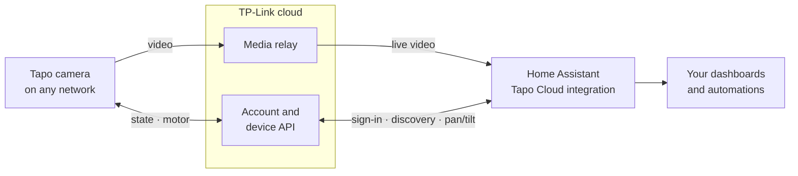
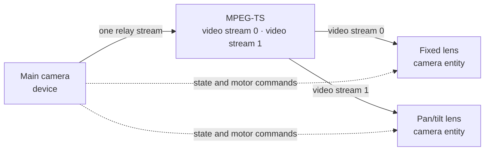

<div align="center">


# Tapo Cloud for Home Assistant

**Your TP-Link Tapo cameras in Home Assistant, from anywhere, through your Tapo account.**

No VPN · No port forwarding · No gateway hardware · No camera-local password

[](https://hacs.xyz/docs/faq/custom_repositories/)
[](https://github.com/Limmi1/ha-tapo-cloud/releases)
[](https://www.home-assistant.io/)
[](LICENSE)

</div>

---

A camera at another house, on someone else's broadband, behind a router you don't control: if the Tapo app can see it, this integration can put it on your dashboard. It talks to TP-Link's own cloud media relay with your account, so the camera's network doesn't matter.

> [!IMPORTANT]
> This is an **unofficial** integration built on [OnTapo](https://github.com/noriellecruz/ontapo), an alpha library for undocumented TP-Link endpoints. It can break without notice, it may conflict with TP-Link's terms of service, and camera **settings cannot be changed** over the cloud. Read **[docs/VERIFICATION.md](docs/VERIFICATION.md)** for exactly what works, what doesn't, and why.

## How it works

Video travels from the camera, through TP-Link's cloud, to Home Assistant. Neither end accepts incoming connections: both connect **out** to the cloud, which is why the camera can be on any network and no ports need opening.



## Contents

- [Features](#features)
- [Check it works for you first](#check-it-works-for-you-first)
- [Installation](#installation)
- [Setup](#setup)
- [Using it](#using-it)
- [Dual-lens cameras](#dual-lens-cameras)
- [Security and privacy](#security-and-privacy)
- [How it compares](#how-it-compares)
- [Documentation](#documentation)
- [Contributing](#contributing)

## Features

| | Over the cloud |
|---|---|
| Sign in with your Tapo account, including two-factor codes | ✅ |
| Automatic discovery of every camera on the account | ✅ |
| Cameras on separate routers and internet connections | ✅ the point of the project |
| Live video in the camera pop-up and on dashboards | ✅ |
| Snapshots that appear instantly (last frame shown while a new one loads) | ✅ |
| Dual-lens cameras, each lens as its own camera | ✅ |
| Pan, tilt and presets | ✅ |
| Availability tracking and automatic reconnection | ✅ |
| Motion detection and privacy mode **state** | ✅ read-only |
| **Changing** motion detection or privacy mode | ❌ the cloud refuses all setting changes ([why](docs/VERIFICATION.md#risks-this-integration-has-to-live-with)) |
| SD-card playback, two-way audio | ❌ not yet |

Verified end to end against real cameras on a separate network: live 2304×1296 H.264 video, both lenses of a dual-lens camera, and pan/tilt commands, all over TP-Link's relay with no LAN path to the camera.

## Check it works for you first

A two-minute standalone check, without touching Home Assistant:

```bash
pip install ontapo==0.1.0
python scripts/verify_remote_stream.py
```

It signs in (you type your own password and code), lists your cameras, opens a relay session to the one you pick, confirms the relay address is public and outside your own network, then decodes a few seconds of video and reports the codec and resolution. Choose a camera on a **different network** from the computer you run it on.

## Installation

### HACS (recommended)

1. In HACS, open **⋮ → Custom repositories**
2. Add `https://github.com/Limmi1/ha-tapo-cloud` with category **Integration**
3. Search for **Tapo Cloud**, then **Download**
4. Restart Home Assistant

HACS then tells you when an update is available.

### Without HACS: from Home Assistant's terminal

With the **Advanced SSH & Web Terminal** add-on, install or update to a given release in one go. Set `V` to the version you want from the [releases page](https://github.com/Limmi1/ha-tapo-cloud/releases):

```bash
V=0.1.7; cd /tmp && curl -sL https://github.com/Limmi1/ha-tapo-cloud/archive/refs/tags/v$V.tar.gz | tar xz && sudo cp -r ha-tapo-cloud-$V/custom_components/tapo_cloud /config/custom_components/ && grep version /config/custom_components/tapo_cloud/manifest.json && ha core restart
```

The `grep` line prints the installed version before Home Assistant restarts. `sudo` is needed because `/config/custom_components` belongs to root on Home Assistant OS.

### Manual

Copy `custom_components/tapo_cloud/` into your Home Assistant `config/custom_components/` folder and restart.

### Requirements

- Home Assistant **2024.11** or newer
- **ffmpeg** for live video and snapshots. Home Assistant OS and the Container image already include it.

## Setup

**Settings → Devices & Services → Add Integration → Tapo Cloud**

Enter the email and password of the Tapo account that owns the cameras. If TP-Link asks for a second factor, choose to receive a code in the Tapo app or by email and type it in. A code with a hyphen, like `150-791`, works as well.

Your password is used to sign in and request that code, then discarded. Only the session token is stored, and it's renewed automatically. If renewal ever fails, Home Assistant asks you to sign in again rather than quietly going stale.

### Options

**Settings → Devices & Services → Tapo Cloud → Configure**

| Option | Default | When to change it |
|---|---|---|
| Live stream quality | `HD` | `VGA` on a slow connection |
| Minimum seconds between snapshots | `30` | How often a tile's picture is refreshed in the background |
| Relay region host | `aps1-cipc-api…` | Only if live view fails with a relay error ([guide](docs/TROUBLESHOOTING.md#live-view-fails-snapshots-fail-everything-else-works)) |

## Using it

Each camera becomes a device with a camera entity, plus sensors for whatever that model reports.

- **Tiles:** a **Picture Entity** or **Picture Glance** card shows the latest picture. It appears instantly (the last frame) and refreshes in the background.
- **Live video:** tap a tile (with `tap_action: more-info`) to open the camera pop-up with live video.

### Pan and tilt

```yaml
action: tapo_cloud.pan
target:
  entity_id: camera.garden
data:
  steps: 80   # negative pans the other way; 10 is a nudge, 150 a sweep
```

`tapo_cloud.tilt` works the same way (positive tilts up). `tapo_cloud.move_to_preset` takes a preset id saved on the camera. The camera decides whether it can move: a model without a motor replies with a clear "has no pan/tilt motor" error.

<details>
<summary><b>A ready-made pan/tilt card</b> (live view with arrow buttons)</summary>

Replace `camera.my_ptz_camera` with your camera. On a dual-lens camera, use the pan/tilt lens's entity: moves sent to a lens reach the camera's motor.

```yaml
type: picture-elements
title: Pan / tilt
camera_image: camera.my_ptz_camera
camera_view: live
elements:
  - type: icon
    icon: mdi:chevron-up
    tap_action: &move
      action: perform-action
      perform_action: tapo_cloud.tilt
      target:
        entity_id: camera.my_ptz_camera
      data:
        steps: 30
    style: &button
      top: 12%
      left: 50%
      color: white
      background-color: rgba(0, 0, 0, 0.45)
      border-radius: 50%
      padding: 6px
      "--mdc-icon-size": 40px
  - type: icon
    icon: mdi:chevron-down
    tap_action:
      <<: *move
      data:
        steps: -30
    style:
      <<: *button
      top: 88%
  - type: icon
    icon: mdi:chevron-left
    tap_action:
      <<: *move
      perform_action: tapo_cloud.pan
      data:
        steps: -30
    style:
      <<: *button
      top: 50%
      left: 8%
  - type: icon
    icon: mdi:chevron-right
    tap_action:
      <<: *move
      perform_action: tapo_cloud.pan
      data:
        steps: 30
    style:
      <<: *button
      top: 50%
      left: 92%
```

If left and right are swapped for your camera, swap the two pan `steps` values.

</details>

### About the privacy switch

The switch shows the camera's real privacy-mode state, but turning it on or off will fail with *"the Tapo cloud rejected this change"*. That's TP-Link's gateway refusing every setting change before the camera sees it, not a fault here. Use the Tapo app to change settings. The switch is kept because the restriction is server-side and may lift.

## Dual-lens cameras

A dual-lens camera (a fixed wide lens plus a pan/tilt lens) appears as **three** cameras: the main camera and one per lens. The cloud lists each lens as its own device but won't stream or answer for a lens directly, so the integration does what the Tapo app does: it opens **one** relay stream on the main camera and picks the lens's own video stream out of it.



- **The main camera's picture** is lens 0, the same as the first lens.
- **Availability, privacy and motion state** for a lens come from the main camera, which is polled once for all of them.
- **Pan/tilt** can be sent to the main camera or to the pan/tilt lens; either way it reaches the motor.

## Security and privacy

- **Your password is never stored.** It's used during sign-in only. Home Assistant keeps the session token.
- **Treat the token like a password.** It grants access to every camera on the account until it expires, so a Home Assistant backup that contains it deserves the same care.
- **Nothing sensitive in logs or diagnostics.** Tokens are never logged; diagnostics redact the token, email address and device ids.
- **No footage on disk.** Snapshots are decoded entirely in memory, through pipes to ffmpeg, with no temporary files.
- **TLS everywhere.** All traffic goes to `*.tplinkcloud.com`, verified against the system trust store plus TP-Link's public CA. Verification is never disabled.

See [SECURITY.md](SECURITY.md) to report a vulnerability. Only use this with cameras you own, and mind the recording-consent law where you live.

## How it compares

| | Tapo Cloud (this) | [Tapo Control](https://github.com/JurajNyiri/HomeAssistant-Tapo-Control) |
|---|---|---|
| Connection | TP-Link cloud relay | Local network |
| Cameras on another network | ✅ | ❌ without VPN or port forwarding |
| Change camera settings | ❌ | ✅ |
| Works when TP-Link's cloud is down | ❌ | ✅ |
| Depends on undocumented endpoints | Yes | No |

**Use Tapo Control for cameras on your own network** — it's local, mature and fully featured. Use Tapo Cloud for the cameras it can't reach. Tapo Control is local-only by policy ([issue #1301](https://github.com/JurajNyiri/HomeAssistant-Tapo-Control/issues/1301)), so this project keeps its cloud transport self-contained in case that ever changes; see [docs/ARCHITECTURE.md](docs/ARCHITECTURE.md).

## Documentation

| | |
|---|---|
| [ARCHITECTURE.md](docs/ARCHITECTURE.md) | How it's built, with diagrams: layers, live video, snapshots, dual-lens cameras |
| [TROUBLESHOOTING.md](docs/TROUBLESHOOTING.md) | Sign-in, pictures, live view, pan/tilt, updating, and what to include in a bug report |
| [VERIFICATION.md](docs/VERIFICATION.md) | Source, licence and security review of OnTapo, and what has been verified live |
| [CHANGELOG.md](CHANGELOG.md) | Release history |

## Contributing

Bug reports, compatibility reports for other camera models, and pull requests are all welcome. See [CONTRIBUTING.md](CONTRIBUTING.md).

```bash
python -m venv .venv && . .venv/bin/activate
pip install -r requirements-test.txt
ruff check . && pytest
```

The test suite runs with no network, no account and no camera.

## Credits

- [OnTapo](https://github.com/noriellecruz/ontapo) by Norielle Cruz (MIT): the cloud protocol work this builds on
- [pytapo](https://github.com/JurajNyiri/pytapo) and [Tapo Control](https://github.com/JurajNyiri/HomeAssistant-Tapo-Control) by Juraj Nyíri: the local-first integration this complements

---

<sub>MIT licensed. Not affiliated with, authorised by or endorsed by TP-Link. "TP-Link" and "Tapo" are trademarks of their respective owners and are used here only to identify compatible hardware.</sub>
