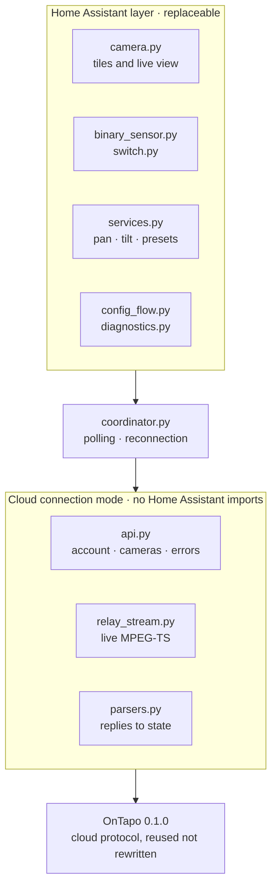
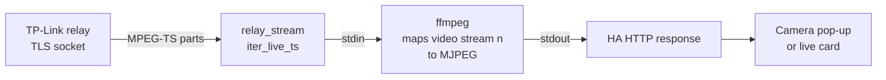
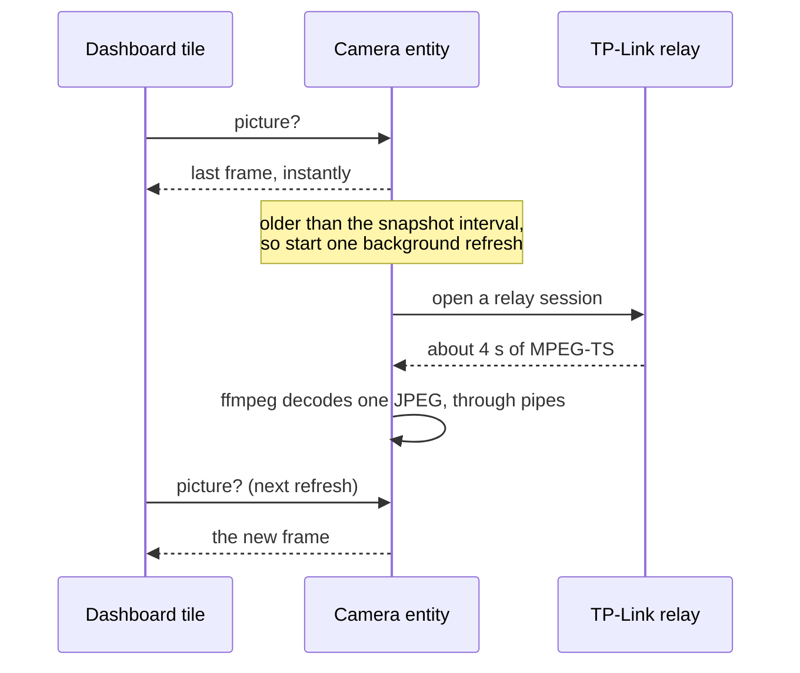
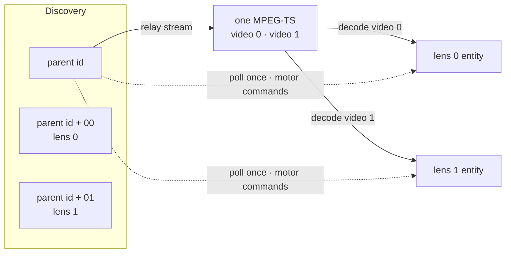

# Architecture

The integration is split so the cloud transport is separable from the Home
Assistant entity layer. The transport could be contributed to
[HomeAssistant-Tapo-Control](https://github.com/JurajNyiri/HomeAssistant-Tapo-Control)
as an optional *cloud connection mode* alongside its local (pytapo) mode,
without bringing any of this repository's entity code along.

## Layers

`api.py`, `parsers.py` and `relay_stream.py` **import no Home Assistant code**,
and their tests run without it. Together they are the whole cloud connection
mode:

- **`TapoCloudAccount`**: sign-in (with MFA), token renewal, camera discovery
  including [lens mapping](#multi-lens-cameras). Yields `CameraInfo` records.
- **`TapoCloudCamera`**: one camera or lens: `iter_live_ts()`,
  `async_snapshot()`, `async_poll()`, pan/tilt/preset, attempted setters.
- **`parsers.py`**: pure functions turning raw device replies into state,
  tolerant of how differently models nest their answers.
- **`relay_stream.py`**: the relay session itself, as an async generator.

Errors are translated at this boundary into a transport-neutral vocabulary
(`CloudAuthError`, `CloudTransportError`, `CloudSetterRejected`), so the entity
layer never catches an OnTapo-specific exception. A local connection mode
raising the same exceptions would slot in behind the same coordinator.

## Live video

The relay delivers MPEG-TS over a TLS socket we hold open ourselves. Home
Assistant's `stream` component needs a URL to hand to go2rtc, and the relay
offers none, so live view is served the way HA serves any push-only source:
transcoded to multipart MJPEG by ffmpeg.

When live view opens, the last cached frame is sent first so the card is never
blank, then ffmpeg's frames follow. ffmpeg scales frames to the *Live view
width* (default 1280 px, never upscaling) and caps them at the *Live view frame
rate* (default 5 fps). The camera's native 2304×1296 at about 14 fps is around
3.5 MB/s per viewer.

The relay session, the ffmpeg process and the HTTP response are torn down
together: whichever goes away first (closing the pop-up, a relay drop, ffmpeg
exiting) stops the other two.

## Snapshots

Pulling a fresh picture takes several seconds: a relay session, about four
seconds of video, and an ffmpeg decode. So tiles never wait for one. The last
frame is returned immediately, and a newer one is fetched in the background
("stale while revalidate").

- At most **one** background refresh runs per camera, however many cards ask.
- Only the very first picture after start-up is waited for.
- If a refresh fails, the last good frame keeps showing, and a warning is
  logged once per failing streak, not once per attempt.
- Video goes to ffmpeg and the JPEG comes back over pipes: no temporary files
  and no blocking file I/O on Home Assistant's event loop.

## Multi-lens cameras

A dual-lens camera is listed by the cloud as a **parent** device plus one
device per lens, whose id is the parent's id with a two-digit lens number
appended (`…00`, `…01`). The cloud refuses both passthrough calls and relay
streams addressed to a lens id. Everything therefore goes to the parent:

What was established live, with a temporary probe in 0.1.4:

| Request | Result |
|---|---|
| Any preview, even `"channels":[0]` | **Two** video streams in the MPEG-TS, one per lens |
| `"channels":[0,1]`, decoding video stream 1 | The other lens (thumbnail difference 44.9, against 0.2 for the same lens) |
| `"channels":[1]` alone | Ignored: still lens 0 |
| A relay path built the way the Tapo app formats it | Refused, HTTP 401 |
| Any change to the cloud's signed relay URL | Refused, HTTP 401 (the 0.1.2 regression) |

So the lens is chosen by **video stream index**, not by the relay request.
Lens 0 (and every ordinary camera) sends exactly OnTapo's own request. Another
lens asks for `[0, n]` on its own track name, and decodes video stream *n*.

Polling is shared too: a lens returns its parent's poll result, reused for up
to 60 seconds, so the parent is queried once rather than once per lens.

## Availability

The cloud's status check (a passthrough `device_info` call) fails
intermittently, often with HTTP 408, while the camera's video relay keeps
working. Marking a camera unavailable on one such failure made Home Assistant
revoke the entity's access token, which blanked every open live view. So:

- a camera goes unavailable only after **three** failed polls in a row (about
  six minutes), and until then its last good state is kept;
- video or a snapshot from the **physical camera** in the last five minutes
  proves it online, whatever the poll says. Every lens counts for its camera;
- every camera and lens follows this same rule.

## Token renewal

A renewal is triggered when the cloud rejects the token. Two paths can trigger
it:

- the **poll** (every two minutes) renews and retries once;
- **media** (snapshots and live view) renews at most once every **five
  minutes** across the whole account, and renewals by the poll count towards
  that.

The media limit exists because a relay that keeps refusing would otherwise
renew the account token on every snapshot of every card, roughly every 30
seconds per card, risking rate limiting or a locked account.

## Reuse of OnTapo internals

OnTapo's public `stream_preview()` records a *fixed number of seconds to a
file path*; Home Assistant needs an open-ended stream. Rather than reimplement
the protocol, `relay_stream.py` calls OnTapo's public `request_relay()` and
then its private framing helpers (`_open_relay`, `_control_frame`,
`_read_part`, …), and `api.py` re-sends the MFA code request in the shape the
live server requires. The coupling is contained:

- it lives in those two places only;
- `assert_ontapo_compatible()` checks every reused symbol at setup and raises a
  clear error if one has moved;
- the test suite asserts the same list, so a dependency bump fails CI rather
  than a user's dashboard;
- `ontapo` is pinned exactly in `manifest.json`.

If OnTapo grows a streaming API, `relay_stream.py` collapses to a thin wrapper
over it, which would also be the right contribution back to OnTapo.

## Testing

142 tests, none of which touch a network, an account or a camera:

| Area | Approach |
|---|---|
| `parsers.py` | pure unit tests over real-world reply shapes |
| `api.py` | mocked OnTapo session: error translation, lens mapping, shared polling, the renewal limit |
| `relay_stream.py` | a scripted fake relay: parts, refusals, idle timeouts, the exact request for each channel |
| ffmpeg | real ffmpeg, when installed: decoding a frame, picking the second of two video streams, and live view's scaling, frame-rate cap and output |
| config flow | `pytest-homeassistant-custom-component`, including MFA and that the password is never stored |
| entities | full Home Assistant setup against a fake account: instant last frame, a single background refresh, failure logging, MJPEG plumbing |
| coordinator | renew-and-retry, riding out failed polls, recent video as proof of life |

Several tests pin a regression found live: the relay URL must never be
altered, lens 0 must match OnTapo's request byte for byte, and a stale frame
must come back without waiting. Each fails on the code that had the bug.
