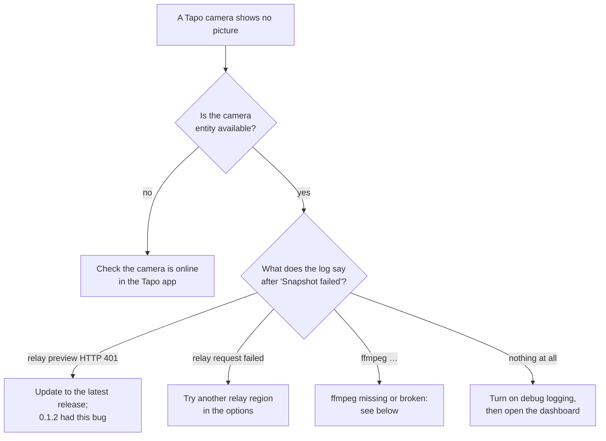

# Troubleshooting

Turn on debug logging first — most of these have a specific message behind
them. In `configuration.yaml`:

```yaml
logger:
  default: info
  logs:
    custom_components.tapo_cloud: debug
```

Or switch it on **without a restart**, from **Developer tools → Actions**:
`logger.set_level` with `custom_components.tapo_cloud: debug`. It turns itself
off at the next restart.

Tokens are never written to the log at any level, so a debug log is safe to
share. Snapshot failures are logged as a warning even without debug logging,
once per camera each time they start failing.



Diagnostics (**Devices & Services → Tapo Cloud → ⋮ → Download
diagnostics**) redact the token, refresh token, email and device ids.

---

## Setup

### "Incorrect email or password"

The credentials are the ones for the **Tapo app account that owns the
cameras**, not a camera-local password and not a TP-Link ID that merely has
the cameras shared with it. Shared accounts are not supported: the relay
authorises the owner.

### No verification code arrives

The code is sent by email, which is the only delivery method implemented. Check
spam. If your account is set up for SMS-only MFA, setup will fail — there is no
workaround here yet.

### "That Tapo account is already set up"

One config entry per account; all its cameras come in through that entry. To
start over, delete the existing entry first.

### "No Tapo cameras found on account"

The account has no cameras, or they are shared rather than owned. Confirm with
the verification script, which lists exactly what the account can see:

```bash
python scripts/verify_remote_stream.py
```

---

## Live video

### Live view fails, snapshots fail, everything else works

Almost always **the relay region**. OnTapo 0.1.0 hardcodes the
relay-negotiation host to ap-southeast-1. Everything except the media path uses
region-correct hosts, which is why login and discovery succeed while the stream
does not.

Try another region in **Settings → Devices & Services → Tapo Cloud →
Configure → Relay region host**:

| Region | Host |
|---|---|
| Asia-Pacific (default) | `aps1-cipc-api.i.tplinkcloud.com` |
| Europe | `euw1-cipc-api.i.tplinkcloud.com` |
| US | `use1-cipc-api.i.tplinkcloud.com` |

You can try them quickly outside Home Assistant:

```bash
python scripts/verify_remote_stream.py --relay-host euw1-cipc-api.i.tplinkcloud.com
```

The field accepts any hostname, so if you discover the right one for your
region, it will work — and please open an issue so it can be added to the list.

### "Tapo Cloud needs ffmpeg to serve a live feed"

Live video and snapshots both need ffmpeg. Home Assistant OS and the Container
image include it. On a bare Core install, install ffmpeg system-wide or add the
FFmpeg add-on; the integration uses whichever binary Home Assistant's own
ffmpeg component is configured with, so no path needs setting here.

### The card shows a still image that updates slowly

That is the snapshot, not the live stream. Tiles show the **last frame at
once** and fetch a newer one in the background, at most every *Minimum seconds
between snapshots* (default 30). Lowering it refreshes tiles more often, at the
cost of more cloud traffic; it won't make the tile live. Tap the tile for the
live feed (the card needs `tap_action: more-info`).

### The first picture after a restart takes a few seconds

Expected. Until a camera has delivered one frame, there's nothing to show while
waiting. Every picture after that appears instantly.

### Both lenses of a dual-lens camera show the same picture

Update to **0.1.5 or later**. Each lens is a separate video stream inside one
relay stream (see [ARCHITECTURE.md](ARCHITECTURE.md#multi-lens-cameras));
releases before 0.1.5 always decoded the first one.

### Every camera fails with "relay preview HTTP 401" after updating

That was a bug in **0.1.2**, fixed in **0.1.3**: it altered the cloud's signed
relay address, which the relay rejects. Update to the latest release.

### Live view takes a few seconds to start

Unavoidable: relay negotiation, then a TLS handshake, then waiting for a
keyframe. Setting the stream quality to `VGA` helps on a slow connection.

### Live view works, then stops after a while

Check the log for `live stream for ... ended`. The relay or the camera closed
the session; reopening the card starts a new one. A camera on a flaky
connection at the far end will do this. If it is persistent, try `VGA`.

### Several people watching one camera

Fine — the relay fans one live stream out to many viewers. (Recording
*downloads* are exclusive per camera, but this integration does not use them.)

---

## Entities

### A camera shows as unavailable

Since 0.1.8 a camera only goes unavailable after **three failed status checks
in a row** (about six minutes), and never while video or a snapshot from it
arrived in the last five minutes. Brief cloud hiccups, which are common, no
longer blank the dashboard. If it still goes unavailable, the camera really
isn't reachable through the cloud:

The cloud answered but the camera did not. Check it is online in the Tapo app:
the usual causes are at the camera's end — power, its own internet connection,
or a firmware update in progress. The integration polls every two minutes and
recovers on its own; nothing needs restarting.

### Motion detection or privacy mode shows "unavailable"

That model did not report the feature (the device answers `-40101`,
"unsupported"). It is deliberately shown as unknown rather than as "off", so
automations do not act on a value the camera never sent.

### The privacy switch throws "the Tapo cloud rejected this change"

Expected, and not a bug in this integration. TP-Link's gateway validates method
names against a per-model schema and refuses every setting write *before the
camera sees it* (`MODEL_SCHEMA_CHECK_FAILED`). Reads work; pan, tilt and
presets work, because motor moves are whitelisted.

To change settings, use the Tapo app or a local connection
([HomeAssistant-Tapo-Control](https://github.com/JurajNyiri/HomeAssistant-Tapo-Control)
if the camera is on your LAN). Details in
[VERIFICATION.md](VERIFICATION.md#risks-this-integration-has-to-live-with).

### Pan/tilt says "has no pan/tilt motor (the camera says so)"

Since 0.1.6 the move is sent straight to the camera, and this message means the
camera itself answered "unsupported". If it does in fact pan or tilt, open an
issue with the model. On a **dual-lens** camera, send moves to the main camera
or the pan/tilt lens; both reach the motor.

On **0.1.5 or earlier**, this message came from a check made during discovery,
which missed some pan/tilt models. Update.

### Pan/tilt says "the Tapo cloud rejected this setting change"

TP-Link's gateway refused the command before the camera saw it. Motor moves are
normally allowed, so tell us the model in an issue.

### Pan/tilt fails with "cloud rejected the request for 'motorMove' (HTTP 408)"

The cloud timed out reaching the camera. Since 0.1.8 a 408 is retried twice,
after 0.5 s and 1.5 s, and each one is logged with the cloud's message. If all
three fail, the camera is unreachable through the cloud at that moment. Pan and
tilt are relative moves, so if the cloud timed out *after* the camera had
already moved, a retry moves it a second time.

### Left and right are swapped

Pan direction varies by model. Swap the positive and negative `steps` values
on your buttons. Tilt is consistent: positive moves the view up.

---

## After an update

### Updating without HACS

From the **Advanced SSH & Web Terminal** add-on, set `V` to the release you
want and run:

```bash
V=0.1.8; cd /tmp && curl -sL https://github.com/Limmi1/ha-tapo-cloud/archive/refs/tags/v$V.tar.gz | tar xz && sudo cp -r ha-tapo-cloud-$V/custom_components/tapo_cloud /config/custom_components/ && grep version /config/custom_components/tapo_cloud/manifest.json && ha core restart
```

`sudo` is needed because `/config/custom_components` belongs to root. If
`ha core restart` reports *missing or invalid API token*, you're running it
from a one-off SSH command rather than a login shell: restart from
**Settings → System → ⋮ → Restart** instead.

### "Detected blocking call … inside the event loop" warnings at start-up

Known and harmless: OnTapo loads TP-Link's certificate bundle while setting up,
which Home Assistant reports. Setup carries on normally.

### "ontapo 0.x.y is missing relay internals this integration reuses"

Continuous live streaming drives OnTapo's internal relay framing, because its
public API only records a fixed number of seconds to a file. An OnTapo release
that renames those internals trips this guard at setup, deliberately, instead
of streaming garbage.

Pin the known-good version in `custom_components/tapo_cloud/manifest.json`:

```json
"requirements": ["ontapo==0.1.0"]
```

and open an issue so the integration can be updated.

### Everything broke at once, with no update at either end

Possible, and anticipated: this depends on undocumented endpoints, and a
TP-Link server-side change can end it permanently without notice. Check the
repository's issues to see whether others are affected at the same time.

---

## Reporting a problem

Include:

- Home Assistant version, and how it is installed
- The camera model and firmware (**Devices & Services → the device**)
- Your rough region, and the relay host you have configured
- Redacted diagnostics
- The output of `scripts/verify_remote_stream.py` — this separates "the cloud
  path does not work for me" from "the integration is mishandling it", which is
  the single most useful thing you can establish

Never attach credentials, tokens or camera footage to an issue.
